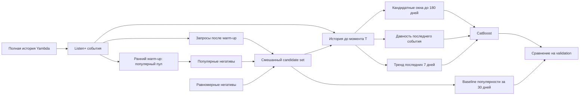
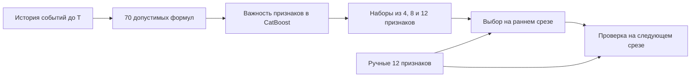

# T-Lab 2026 — RecSys

Проект для первого задания отбора T-Lab 2026: временные признаки, их автоматизированный поиск и бустинговый baseline.

## Материалы

- [Условие задания](Задание.md)
- [Исходный текст условия](Задание-оригинал.txt)
- [Итоговый отчёт](Решение.md)
- [PDF для сдачи](output/pdf/recsys-report.pdf)
- [Журнал разработки и экспериментов](История-исследования.md)

Статус: текущий цикл исследования завершён. Реализованы базовый CatBoost, point-in-time агрегаты и автоматический поиск внутри 70 формул. На итоговой когорте q48 из 7 025 запросов автоматические 8 признаков уступили ручным 12 по NDCG@3 (0.43434 против 0.44435), времени расчёта (+14.2%) и пиковой памяти (+21.9%). Числовая матрица и файл модели меньше, но заданный компромисс качества и затрат не достигнут. Последние 15% времени использованы для итоговой проверки; для выбора формул они не использовались. Метод не обеспечивает полной независимости генерации признаков от человека. Подробности — в отчёте, история исправлений — в журнале.

## MVP

Пайплайн профилирует CSV/TSV/Parquet и обучает pointwise CatBoost baseline на candidate-level таблице. DuckDB считает признаки пользователя, объекта и пары; исходные окна по умолчанию — 1, 7 и 30 дней. В признаки запроса T входят только события с временем строго меньше T.

Для baseline обязательны `user_id`, `item_id`, `timestamp`, `label`. В CTR-задаче метка 0 должна означать реально показанный, но не кликнутый объект. Если в данных показов нет, ненаблюдавшийся объект нельзя автоматически называть негативом.

## Масштаб из условия

В исходном тексте сказано, что академические датасеты могут содержать около 1 млн взаимодействий, а production-датасеты — 1 млрд, 100 млрд и более. Это указано внутри пункта о трансформере и объясняет вопросы масштабируемости этого направления; объём взаимодействий не равен числу запросов сервиса в секунду. В требованиях к MVP с бустингом нет заданного SLA или требования обрабатывать production-объём. Наш MVP обработал историю Yambda-50M на 47,8 млн событий, но production-пропускную способность и миллиардный throughput не проверял.

## Эксперимент на Yambda-50M

Взята официальная [Yambda-50M](https://huggingface.co/datasets/yandex/yambda): 47 790 449 строк, 10 000 пользователей и 934 057 треков в `flat/50m/multi_event.parquet`. Условие публикации и схема описаны в [карточке датасета](https://huggingface.co/datasets/yandex/yambda). Сырые данные и локальные результаты исключены из Git.

В Yambda нет логов показов без взаимодействия, поэтому эксперимент измеряет только ранжирование сэмплированных кандидатов:

- **Позитив:** `event_type = listen` и `played_ratio_pct > 50` (Listen+).
- **Негатив:** объект, не встречавшийся у пользователя до запроса. Половина предложений берётся из пула популярных треков, половина — равномерно из каталога. Популярный пул из 50 000 треков строится на раннем участке данных; этот warm-up не включается в candidate-запросы. Затем проверяется доступность трека к моменту запроса, а уже встречавшиеся объекты и положительные цели исключаются.
- **Семантика:** это сэмплированные неизвестные, не реальные показы без клика и не дизлайки. Возможны ложные негативы, если пользователь послушает трек позже. Метрики нельзя считать качеством CTR-модели или онлайн-эффектом.
- **Время:** исходный `timestamp` задан в секундах с шагом 5 секунд, а не является индексом 5-секундного интервала. В коде benchmark он напрямую сравнивается с `DAY_SECONDS = 86400`; см. [константы Yambda](https://huggingface.co/datasets/yandex/yambda/blob/main/benchmarks/yambda/constants.py) и [time split](https://huggingface.co/datasets/yandex/yambda/blob/main/benchmarks/yambda/processing/timesplit.py). Timestamp преобразуется в микросекунды только при записи в DuckDB, с условным началом эпохи Unix: календарная дата значения не имеет.
- **Разбиение:** наш эксперимент использует собственное глобальное хронологическое разбиение 70/15/15 по квантилям времени. Это не официальный benchmark split Yambda.

### Запуск

    mkdir -p data/raw
    curl -L --fail --output data/raw/yambda-50m-multi_event.parquet https://huggingface.co/datasets/yandex/yambda/resolve/main/flat/50m/multi_event.parquet
    python -m recsys_mvp prepare-yambda data/raw/yambda-50m-multi_event.parquet --query-sample-modulo 2500 --negatives-per-query 50 --negative-strategy mixed --popular-pool-size 50000 --seed 42
    python -m recsys_mvp baseline data/processed/yambda_candidates.parquet --history-input data/processed/yambda_history.parquet --output-dir outputs/yambda-hard-negatives

Препроцессор выбрал 10 341 query timestamp для сэмплирования; ранние 2 069 использовались как warm-up популярного пула. В candidate-набор вошли 8 061 запроса, 9 210 позитивных и 403 050 негативных объектов. Средний набор содержит около 51 кандидата на запрос. После eligibility-фильтров среди негативов 219 829 пришли из популярного пула и 183 221 — из равномерной выборки.



### Исправленные результаты

Оба протокола используют одни и те же 8 061 запроса, одинаковое число негативов и временные границы. Контрольная строка использует только равномерные негативы; основной вариант — смешанные. Для каждого варианта CatBoost и baseline популярности оценены на одном и том же тестовом candidate set. Тест содержит 1 208 запросов и в среднем 51,2 кандидата на запрос.

| Негативы | Модель | NDCG@3 | Recall@3 |
|---|---|---:|---:|
| Равномерные (контроль) | CatBoost | 0.8450 | 0.8811 |
| Равномерные (контроль) | Популярность за 30 дней | 0.6973 | 0.7822 |
| Смешанные: популярные + равномерные | CatBoost | 0.7358 | 0.7622 |
| Смешанные: популярные + равномерные | Популярность за 30 дней | 0.3992 | 0.4673 |

Для смешанных негативов CatBoost также получил AUC 0.9211 и log loss 0.0449. На смешанном наборе CatBoost превосходит baseline популярности. NDCG и Recall ниже, чем на равномерном контроле; это согласуется с гипотезой, что популярные негативы труднее, но модели обучались отдельно под каждую стратегию, поэтому это не изолированный тест одной и той же модели. Это предварительная offline оценка на синтетически сэмплированных кандидатах: качество retrieval, поведение на реальных показах и онлайн-эффект эксперимент не оценивает.

Ранее записанные значения NDCG@3 0.8327 и Recall@3 0.8734 получены с ошибочно растянутыми окнами времени и равномерными негативами. Они удалены из актуальной оценки и не должны сравниваться с новыми метриками.

### Абляция окон — только validation

На тех же кандидатах и временном разбиении сравнили пять конфигураций. Для CatBoost baseline популярности за 30 дней на validation имеет NDCG@3 = 0.4179 и Recall@3 = 0.4886.

| Признаки | NDCG@3 | Recall@3 | Расчёт, с | Обучение, с |
|---|---:|---:|---:|---:|
| Окна 1/7/30 | 0.7519 | 0.7738 | 1.038 | 17.536 |
| Окна 1/3/7/14/30/60/90 | 0.8074 | 0.8237 | 1.795 | 25.374 |
| Широкие окна + тренд | 0.8085 | 0.8216 | 1.959 | 21.389 |
| Широкие окна + давность | **0.8109** | **0.8254** | 1.995 | 28.438 |
| Широкие окна + тренд + давность | 0.8078 | 0.8227 | 2.049 | 24.157 |

Расширенные окна заметно улучшили обе метрики относительно 1/7/30; максимальные метрики в этой первой серии показала конфигурация с давностью последнего события. Последующий поиск отдельных окон уточнил этот вывод. Validation использовался для early stopping и выбора, поэтому это предварительный результат, а не независимая оценка. Во всех запусках test-кандидаты отбрасывались до расчёта признаков, test-метки и метрики не использовались. Пиковая память, число признаков, формулы и ограничения описаны в [абляции в решении](Решение.md#4-временные-окна-и-бюджет-признаков); подробный протокол и вывод — в [журнале](История-исследования.md#6-абляция-временных-признаков).

### Поиск окон при ограничении их числа

Команда `search-windows` начинает с `1/7/30`, по одному пробует окна `3/14/60/90`, на каждом шаге выбирает лучший вариант по validation NDCG@3 и затем проверяет удаление каждого окна из полного набора. Рассмотрено 16 разных наборов. Это жадный поиск плюс групповая абляция, а не перебор всех сочетаний.

| Окна | Всего признаков | NDCG@3 поздний срез | Recall@3 поздний | NDCG@3 ранний срез | Recall@3 ранний | Расчёт признаков, с, поздний |
|---|---:|---:|---:|---:|---:|---:|
| 1/7/30 | 11 | 0.7519 | 0.7738 | 0.7518 | 0.7742 | 1.093 |
| **1/7/30/90** | **14** | **0.8094** | 0.8229 | **0.8205** | **0.8321** | 1.495 |
| 1/7/14/30/90 | 17 | 0.8111 | 0.8267 | 0.8201 | 0.8310 | 1.618 |
| 1/7/14/30/60/90 | 20 | **0.8114** | **0.8270** | 0.8197 | 0.8318 | 1.836 |
| 1/3/7/14/30/60/90 | 23 | 0.8074 | 0.8237 | 0.8180 | 0.8302 | 1.973 |

Поздний срез: обучение до 70-го процентиля времени, validation от 70-го до 85-го (1 208 запросов). Ранний срез: обучение до 50-го, validation от 50-го до 70-го (1 612 запросов). Модель переобучалась на каждом срезе. При лимите четыре окна вариант `1/7/30/90` даёт основной прирост с минимальным числом дополнительных признаков; пятое и шестое окна дают небольшую прибавку только на позднем срезе. Вариант из семи окон слабее более компактных на обоих срезах. Давность события не улучшила NDCG@3 у компактных вариантов. Это сравнение на сэмплированных кандидатах, без оценки финального test и без измерения задержки онлайн-рекомендации. Полный разбор затрат и ограничений — в [решении](Решение.md#поиск-окон-при-бюджете-признаков).

Этот поиск ограничивался горизонтом 90 дней. Следующая проверка 120 и 180 дней приведена ниже; выбор `1/7/30/90` был предварительным в пределах первоначального поиска.

Повторить поиск:

    python -m recsys_mvp search-windows data/processed/yambda_candidates.parquet --history-input data/processed/yambda_history.parquet --output-dir outputs/window-search

Команда сохраняет `summary.json` и JSON/модель для каждого варианта в `outputs/window-search/`. Для проверки другого временного среза у `baseline` есть `--train-quantile` и `--validation-quantile`.

Например, ранняя проверка четырёх окон:

    python -m recsys_mvp baseline data/processed/yambda_candidates.parquet --history-input data/processed/yambda_history.parquet --output-dir outputs/window-search/earlier-slice/windows-1-7-30-90 --windows-days 1,7,30,90 --train-quantile 0.50 --validation-quantile 0.70 --validation-only

Если лимит задан заранее, добавь, например, `--max-windows 4`: поиск не обучит варианты с пятью и более окнами. Таблица выше получена без этого ограничения, чтобы показать компромисс для лимитов от трёх до семи окон.

### Проверка истории длиннее 90 дней

При одинаковых 14 признаках на mixed candidate set модель с окнами `1/7/30/180` дала NDCG@3 **0.8399** на позднем и **0.8443** на раннем validation против 0.8094 и 0.8205 для `1/7/30/90`. Промежуточные 120 дней дали 0.8244 и 0.8327. Основной прирост дала история пары «пользователь — трек»: замена 90 на 180 дней только для пары дала 0.8347 и 0.8452. Пакетный расчёт признаков на позднем срезе занял 1.379 с для 90 дней и 1.611 с для 180; задержка онлайн-рекомендации не измерялась.

**Ограничение:** негативы подбирались только из треков без прежнего взаимодействия пользователя, а позитивные прослушивания могут повторяться. У 6 756 из 9 210 позитивов уже была история этой пары за 180 дней; у негативов её нет по правилу сэмплирования. На диагностической подвыборке без таких повторов (2 193 запроса, отдельное обучение) выигрыш 180 дней по NDCG@3 сократился до 0.0106 на позднем и 0.0093 на раннем срезе. Поэтому 180 дней пока нельзя объявлять лучшим пределом хранения для продакшена. [Методика, остальные метрики и ограничения](Решение.md#проверка-горизонтов-120-и-180-дней) и [запись в журнале](История-исследования.md).

Повторить основное сравнение и отдельную замену окна пары:

    python -m recsys_mvp baseline data/processed/yambda_candidates.parquet --history-input data/processed/yambda_history.parquet --output-dir outputs/long-horizon/late/windows-1-7-30-180 --windows-days 1,7,30,180 --validation-only
    python -m recsys_mvp baseline data/processed/yambda_candidates.parquet --history-input data/processed/yambda_history.parquet --output-dir outputs/long-horizon/late/pair-180-others-90 --windows-days 1,7,30,90 --pair-windows-days 1,7,30,180 --validation-only

Для раннего среза добавь `--train-quantile 0.50 --validation-quantile 0.70` и другой `--output-dir`. Флаги `--user-windows-days`, `--item-windows-days`, `--pair-windows-days` переопределяют окна отдельного семейства; без них используется `--windows-days`. Диагностическую подвыборку можно создать так:

    python -m recsys_mvp cold-pair-control data/processed/yambda_candidates.parquet --history-input data/processed/yambda_history.parquet --output data/processed/yambda_cold_pair_candidates.parquet --lookback-days 180

Затем запусти `baseline` с этой таблицей вместо основной и окнами 90/180 дней. Локальные результаты всех запусков собраны в `outputs/long-horizon/summary.json`; данные и модели не коммитятся.

### Автоматическая генерация признаков: первый эксперимент

`search-features` строит формулы по шаблону `сущность × тип события × окно × агрегат`. На Yambda доступны `listen_plus`, короткое прослушивание, `like` и `dislike`; формулы считают число событий, число разных треков/пользователей и среднюю долю воспроизведения там, где она имеет смысл. Окна: 1/7/30/90/180 дней. Для поиска на новых для пользователя треках используются только признаки пользователя и трека: история пары в таком протоколе по определению пуста. Получается 70 формул.



Ручной контроль заранее фиксирует 12 числовых признаков: число Listen+ пользователя и трека за 1/7/30/90 дней и число разных прослушанных треков/слушателей за 30/90 дней. У обеих моделей дополнительно есть `user_id` и `item_id`. Автоматический отбор обучает CatBoost со всеми формулами на первом временном отрезке, ранжирует формулы по важности, сравнивает лучшие 4/8/12 на следующем отрезке и проверяет выбранный набор на более позднем. Модели для поздней оценки переобучаются без early stopping на этом позднем отрезке. Это эвристика, а не исчерпывающий перебор.

Для основного протокола оставлены только запросы, у которых позитивный трек **никогда раньше не встречался пользователю**. Это убирает найденное преимущество истории пары, но негативы остаются сэмплированными неизвестными, а не реальными показами без клика.

| Выборка и временной срез | Запросов проверки | Популярность 30 дней NDCG@3 | Ручной CatBoost | Автоматический CatBoost | Выбрано числовых признаков |
|---|---:|---:|---:|---:|---:|
| Seed 42, поздний | 276 | 0.3165 | 0.3757 | **0.4159** | 4 |
| Seed 42, ранний | 276 | 0.3065 | 0.3610 | 0.3655 | 8 |
| Seed 43, поздний | 287 | 0.3487 | **0.4177** | 0.3774 | 4 |

На seed 42 поздняя парная разница NDCG@3 составила +0.0402 (95% бутстрэп-интервал по запросам +0.0125…+0.0677), на раннем +0.0044 (−0.0116…+0.0206), на seed 43 **−0.0403** (−0.0745…−0.0056). Поэтому устойчивое превосходство автоматического отбора **не подтверждено**. Оба временных среза и оба seed используются как исследовательские проверки; отдельный финальный test не открывался. Подробности и ограничения — в [решении](Решение.md#5-автоматический-поиск-признаков) и [журнале](История-исследования.md).

В локальном запуске seed 42 генерация всех 70 формул заняла 3.825 с, только ручного набора — 0.956 с, только выбранных четырёх — 0.633 с. Это пакетное время на данной подвыборке, не задержка онлайн-рекомендации.

Повторить основной запуск:

    python -m recsys_mvp prepare-events data/raw/yambda-50m-multi_event.parquet
    python -m recsys_mvp unseen-pair-control data/processed/yambda_candidates.parquet --event-history-input data/processed/yambda_events.parquet
    python -m recsys_mvp search-features data/processed/yambda_unseen_candidates.parquet --event-history-input data/processed/yambda_events.parquet --output-dir outputs/feature-search/unseen

Для раннего среза добавь `--split-quantiles 0.35,0.55,0.70` и другой `--output-dir`. Повтор на seed 43:

    python -m recsys_mvp prepare-yambda data/raw/yambda-50m-multi_event.parquet --candidate-output data/processed/yambda_candidates_seed43.parquet --history-output data/processed/yambda_history_seed43.parquet --query-sample-modulo 2500 --negatives-per-query 50 --negative-strategy mixed --popular-pool-size 50000 --seed 43
    python -m recsys_mvp unseen-pair-control data/processed/yambda_candidates_seed43.parquet --event-history-input data/processed/yambda_events.parquet --output data/processed/yambda_unseen_candidates_seed43.parquet
    python -m recsys_mvp search-features data/processed/yambda_unseen_candidates_seed43.parquet --event-history-input data/processed/yambda_events.parquet --output-dir outputs/feature-search/unseen-seed43

Полные списки формул, выбранных признаков, метрики и затраты сохраняются в `summary.json` каждого запуска.

### Устойчивый отбор и отдельная проверка

`robust-search-features` использует два discovery seed (42 и 43) и по два среза на каждом (35/55/70 и 50/70/85%). В каждом срезе CatBoost ранжирует формулы по важности. Итоговый порядок — средний нормализованный ранг формулы на четырёх срезах. Бюджет выбирается по `средний NDCG@3 − 0.5 × стандартное отклонение NDCG@3`; это поощряет качество, которое меньше меняется между срезами. Seed 44 не участвует в ранжировании формул или выборе бюджета.

| Holdout seed | Проверочных запросов | Популярность 30д NDCG@3 | Ручной CatBoost NDCG@3 / Recall@3 | Устойчивый отбор NDCG@3 / Recall@3 | Δ NDCG@3, 95% парный интервал | Признаков |
|---|---:|---:|---:|---:|---:|---:|
| 44 | 279 | 0.3294 | **0.3927 / 0.4713** | 0.3881 / 0.4624 | −0.0046 [−0.0351; +0.0275] | 8 |

В seed 44 было 1 862 запроса после контроля ранее виденных позитивов; с seed 42 и 43 у него нет общих query ID. Выборка использовалась один раз после фиксации процедуры. Результат близок к ручному контролю, а интервал разницы включает ноль: улучшение автоматического отбора пока не доказано. Поиск бюджетов на discovery folds дал средний NDCG@3 0.3696/0.3731/0.3721 для 4/8/12 признаков; разброс составил 0.0217/0.0144/0.0157, поэтому выбран набор из 8 признаков.

Повторить discovery и holdout-проверку (артефакты создаются локально):

    python -m recsys_mvp prepare-yambda data/raw/yambda-50m-multi_event.parquet --candidate-output data/processed/yambda_candidates_seed44.parquet --history-output data/processed/yambda_history_seed44.parquet --query-sample-modulo 2500 --negatives-per-query 50 --negative-strategy mixed --popular-pool-size 50000 --seed 44
    python -m recsys_mvp unseen-pair-control data/processed/yambda_candidates_seed44.parquet --event-history-input data/processed/yambda_events.parquet --output data/processed/yambda_unseen_candidates_seed44.parquet
    python -m recsys_mvp robust-search-features data/processed/yambda_unseen_candidates.parquet data/processed/yambda_unseen_candidates_seed43.parquet --holdout-input data/processed/yambda_unseen_candidates_seed44.parquet --event-history-input data/processed/yambda_events.parquet --output-dir outputs/feature-search/robust-seed44

Итоговый JSON и CatBoost-модели сохраняются в каталоге `--output-dir`.

### Чувствительность к негативам и составу запросов

Добавлены независимые параметры выборки: `--query-seed` выбирает временные запросы, `--seed` задаёт случайный выбор негативных кандидатов. Если `--query-seed` не указан, он равен `--seed` для совместимости со старыми командами. Границы популярного пула и каталога можно закрепить через `--popular-pool-cutoff-seconds` и `--catalog-cutoff-seconds`.

| Проверка | Запросы аудита | Ручной CatBoost NDCG@3 | Автоматический CatBoost NDCG@3 | Δ авто − ручной, 95% интервал по пользователям |
|---|---:|---:|---:|---:|
| Те же запросы, негативы seed 42 | 285 | 0.3645 | 0.3753 | +0.0108 [−0.0227; +0.0424] |
| Те же запросы, негативы seed 43 | 285 | 0.4023 | 0.3801 | −0.0223 [−0.0590; +0.0130] |
| Те же запросы, негативы seed 44 | 285 | 0.3913 | 0.3880 | −0.0033 [−0.0392; +0.0336] |
| Отдельная когорта q45 | 285 | 0.3645 | 0.3753 | +0.0108 [−0.0227; +0.0424] |
| Отдельная когорта q46 | 282 | 0.3334 | 0.3537 | +0.0203 [+0.0008; +0.0414] |
| Отдельная когорта q47 | 267 | 0.3837 | 0.3884 | +0.0047 [−0.0305; +0.0401] |

В первой части зафиксированы позитивные объекты и query ID (query seed 45), менялись только seed смешанного sampler-а негативов. Jaccard пересечения негативных пар составил 0.000206 для seed 42/43 и 0.000132 для seed 42/44: наборы почти не пересекаются. Модели переобучались на каждом наборе, поэтому метрики отражают совместное влияние обучающих негативов и состава аудита. При этом на одинаковых query ID ручной NDCG@3 между seed 42 и 43 вырос на 0.0379 [0.0026; 0.0743], а между 42 и 44 — на 0.0268 [−0.0105; 0.0646]. Автоматический вариант менялся меньше: соответственно +0.0047 [−0.0270; 0.0362] и +0.0126 [−0.0207; 0.0456].

Затем зафиксировали обучение на train/selection из negative seed 42 (48 447/19 390 строк; модели переобучены на их объединении) и подавали тем же моделям только audit-пулы 42/43/44. На всех пулах совпадают 285 audit query и позитивные кандидаты; один и тот же пользовательский bootstrap использует 2 000 ресэмплов.

| Audit negative seed | Ручной NDCG@3 | Δ к пулу 42, 95% интервал | Авто NDCG@3 | Δ к пулу 42, 95% интервал |
|---:|---:|---:|---:|---:|
| 42 | 0.3645 | — | 0.3753 | — |
| 43 | 0.3514 | −0.0130 [−0.0422; +0.0165] | 0.3598 | −0.0155 [−0.0453; +0.0129] |
| 44 | 0.3599 | −0.0046 [−0.0359; +0.0255] | 0.3718 | −0.0035 [−0.0303; +0.0231] |

Все четыре интервала включают ноль: на этих 285 запросах одна лишь замена audit-негативов не показала надёжного сдвига средней NDCG. Это не доказывает отсутствия эффекта; интервалы широкие.

Затем проведена полная матрица `train seed × audit seed`: каждая модель обучалась на одном из пулов 42/43/44 и оценивалась на каждом из трёх. Запросы аудита, позитивы, временные границы и число кандидатов (14 542 строки, 285 запросов) совпадали. Для ручной модели переход с train seed 42 на 43 дал прирост NDCG@3 от +0.0269 до +0.0509 на всех audit-пулах; пользовательские 95% интервалы исключили ноль на двух из трёх пулов. Для автонабора эффекты были +0.0053…+0.0230, все интервалы включали ноль. При фиксированном обучении замена audit-пула не дала различимого сдвига ни для одной модели. Все взаимодействия train seed × audit seed тоже имеют интервалы, включающие ноль. Это указывает на чувствительность обученной ручной модели к выбранным негативам, но три seed на одной query-когорте не доказывают обобщаемый эффект; сравнения множественные, коррекция не применялась. Полная матрица и интервалы — в [решении](Решение.md#чувствительность-к-сэмплированию) и [журнале](История-исследования.md#13-матрица-train-seed--audit-seed--2026-10-11).

На тех же пулах сравнили CatBoostClassifier и CatBoostRanker с группами `query_id`, отдельно для ручных и автоматических признаков. В контрольном повторе обе модели выбирали число итераций по NDCG@3: точечная NDCG Ranker оказалась выше в 18 из 18 сравнений, но парные 95% интервалы исключили ноль только в 2 из 18; средний прирост — +0.0140 и +0.0181 для ручного и автоматического признаков. Это оставляет ranking objective перспективным, но не доказывает устойчивое преимущество Ranker на независимых данных. [Методика и результаты](Решение.md#сравнение-catboostclassifier-и-catboostranker), журнал обеих версий: [запись 14](История-исследования.md#14-pointwise-классификатор-против-catboostranker--2026-10-11), полный контролируемый отчёт: `outputs/sampling-sensitivity/objective-and-sampler-controlled/summary.json`.

### Подбор параметров CatBoost

Проверили 8 конфигураций на двух discovery query-когортах; selection и early stopping использовали NDCG@3. Лучшая конфигурация (`depth=8`, `learning_rate=0.10`, `l2_leaf_reg=3`) затем сравнивалась с фиксированными параметрами (`depth=8`, `learning_rate=0.05`, `l2_leaf_reg=3`) на q47. Разница NDCG@3 составила +0.00017, парный пользовательский 95% интервал [−0.0060; +0.0064]. Убедительного улучшения нет; локальный поиск не доказывает, что мы нашли глобально лучший CatBoost. Методика и ограничения — [в решении](Решение.md#подбор-параметров-catboost), полный журнал — [запись 15](История-исследования.md#15-подбор-параметров-catboost-и-требование-масштабирования--2026-10-11).

Во второй части зафиксированы негативный seed 42, популярный пул и каталог. Query seed 45/46/47 формируют непересекающиеся по query ID когорты; запросы с пересечением с прежними выборками и между новыми когортами исключены. Пользователи между когортами могут повторяться. Бутстрэп-интервалы используют 2 000 выборок пользователей, сохраняя все запросы выбранного пользователя в одном кластере.

Точечное преимущество автонабора неустойчиво: по трём когортам разница составляет +0.0108, +0.0203 и +0.0047, а два из трёх интервалов включают ноль. Это не подтверждает преимущество автоматического отбора и показывает, что состав запросов и candidate sampler нужно контролировать при сравнении. Метки негативов по-прежнему означают «не встретился в логах», а не «был показан без клика»; результаты не оценивают CTR на реальных показах. Более плотная итоговая проверка q48 приведена ниже.

Повторить наборы (после первой команды используй записанные в metadata границы пула и каталога `6524410` и `21381550`):

    python -m recsys_mvp prepare-yambda data/raw/yambda-50m-multi_event.parquet --candidate-output data/processed/yambda_candidates_q45_n42.parquet --history-output data/processed/yambda_history_q45_n42.parquet --query-sample-modulo 2500 --negatives-per-query 50 --negative-strategy mixed --popular-pool-size 50000 --seed 42 --query-seed 45
    python -m recsys_mvp prepare-yambda data/raw/yambda-50m-multi_event.parquet --candidate-output data/processed/yambda_candidates_q45_n43.parquet --history-output data/processed/yambda_history_q45_n43.parquet --query-sample-modulo 2500 --negatives-per-query 50 --negative-strategy mixed --popular-pool-size 50000 --seed 43 --query-seed 45 --popular-pool-cutoff-seconds 6524410 --catalog-cutoff-seconds 21381550
    python -m recsys_mvp prepare-yambda data/raw/yambda-50m-multi_event.parquet --candidate-output data/processed/yambda_candidates_q46_n42.parquet --history-output data/processed/yambda_history_q46_n42.parquet --query-sample-modulo 2500 --negatives-per-query 50 --negative-strategy mixed --popular-pool-size 50000 --seed 42 --query-seed 46 --popular-pool-cutoff-seconds 6524410 --catalog-cutoff-seconds 21381550

Для seed 44 и 47 повтори команды с `--seed 44 --query-seed 45` и `--seed 42 --query-seed 47` соответственно. Затем примени `unseen-pair-control` к каждому набору и передай три отрицательных и три query-варианта в `sampling-sensitivity`. Полная команда эксперимента, разрезы, пары seed и метрики записаны в [журнале](История-исследования.md); полный локальный JSON лежит в `outputs/sampling-sensitivity/negative-and-query-seeds/summary.json`.

### Проверка стоимости автоматических признаков

[Протокол](experiments/feature-efficiency-protocol.md) зафиксирован до запуска. В нём сравниваются ручные 12 и ранее выбранные автоматические 8 числовых признаков на новой когорте q48; запросы прежних экспериментов исключаются. [Выбранные формулы](experiments/feature-efficiency-selection.json) сохранены в проекте и не переотбираются.

```bash
python -m recsys_mvp.feature_efficiency
```

Команда готовит более плотную выборку, обучает обе модели с одинаковыми параметрами, проверяет последние 15% времени и измеряет расчёт audit-признаков в отдельных последовательных процессах: один прогрев и пять повторов на вариант. Обучающая матрица собирается пакетами по 2 000 запросов. Для продолжения незавершённого запуска после подготовки кандидатов используется `--resume`; завершённый отчёт не перезаписывается.

Перед запуском нужны `data/raw/yambda-50m-multi_event.parquet`, нормализованная история `data/processed/yambda_events.parquet` и candidate-файлы предыдущих опытов из разделов выше, чтобы воспроизвести исключения query ID. Точный список 18 файлов сохранён в `experiments/feature-efficiency-selection.json` и переносится в manifest; при отсутствии любого файла команда завершится до запуска эксперимента. Дополнительные локальные candidate-файлы список исключений не меняют. Артефакты сохраняются в `outputs/feature-efficiency/`; новый каталог задаётся через `--output-dir`.

Совместный критерий: ускорение не менее 20%, рост peak RSS не более 5% и подтверждённая пользовательским bootstrap-интервалом потеря NDCG не более 2% относительно ручного контроля. Допуск выбран для исследования; это не SLA и не бизнес-оценка. Результат и ограничения — в [журнале](История-исследования.md#16-стоимость-автоматических-признаков--2026-10-12).

**Результат:** на 7 025 audit-запросах NDCG@3 составила 0.43434 против 0.44435 у ручного контроля. Автоматический расчёт медленнее на 14.2%, peak RSS выше на 21.9%; совместный критерий не выполнен. Числовая матрица меньше на 33.3%, файл модели — на 93.8%, но с потерей качества. [Таблица и интерпретация](Решение.md#7-проверка-стоимости-на-новой-выборке), [все измеряемые повторы и интервалы](experiments/feature-efficiency-result.json).

## Запуск общего baseline

Используй Python 3.11 или новее:

    python3.14 -m venv .venv
    source .venv/bin/activate
    python -m pip install -r requirements.txt
    python -m recsys_mvp profile data/interactions.parquet
    python -m recsys_mvp baseline data/candidate_examples.parquet

Для повторения проверки только на validation добавь к команде `--validation-only`. Конфигурацию окон задаёт `--windows-days 1,3,7,14,30,60,90`; `--include-trends` добавляет сравнение последних двух 7-дневных отрезков, `--include-recency` — давность последнего Listen+ в самом длинном окне. Например:

    python -m recsys_mvp baseline data/processed/yambda_candidates.parquet --history-input data/processed/yambda_history.parquet --output-dir outputs/feature-ablation/windows-plus-recency --windows-days 1,3,7,14,30,60,90 --include-recency --validation-only

Имена колонок можно задать через `--user-column`, `--item-column`, `--timestamp-column`, `--label-column` и `--query-column`. JSON с метриками и модель сохраняются в `outputs/`; локальные результаты не попадают в Git.
