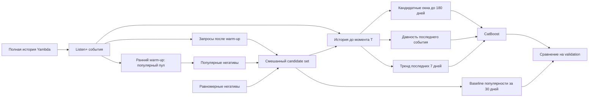

# T-Lab 2026 — RecSys

Отдельный проект для первого задания отбора T-Lab 2026: временные признаки, их автоматизированный поиск и бустинговый baseline.

## Материалы

- [Условие задания](Задание.md)
- [Черновик решения и план исследования](Решение.md)
- [Журнал разработки и экспериментов](История-исследования.md)

Статус: MVP запущен на Yambda-50M. Исправлен масштаб timestamp, проведены validation-абляция, поиск окон и пилот автоматической генерации признаков. Найдено смещение от способа сэмплирования негативов; текущий автоматический отбор признаков нестабилен между выборками. Финальный test для выбора конфигурации не использовался. Старые метрики до исправления времени считаются недействительными.

## MVP

Пайплайн профилирует CSV/TSV/Parquet и обучает pointwise CatBoost baseline на candidate-level таблице. DuckDB считает признаки пользователя, объекта и пары; исходные окна по умолчанию — 1, 7 и 30 дней. В признаки запроса T входят только события с временем строго меньше T.

Для baseline обязательны `user_id`, `item_id`, `timestamp`, `label`. В CTR-задаче метка 0 должна означать реально показанный, но не кликнутый объект. Если в данных показов нет, ненаблюдавшийся объект нельзя автоматически называть негативом.

## Эксперимент на Yambda-50M

Взята официальная [Yambda-50M](https://huggingface.co/datasets/yandex/yambda): 47 790 449 строк, 10 000 пользователей и 934 057 треков в `flat/50m/multi_event.parquet`. Условие публикации и схема описаны в [карточке датасета](https://huggingface.co/datasets/yandex/yambda). Сырые данные и локальные результаты исключены из Git.

В Yambda нет логов показов без взаимодействия, поэтому эксперимент измеряет только ранжирование сэмплированных кандидатов:

- **Позитив:** `event_type = listen` и `played_ratio_pct > 50` (Listen+).
- **Негатив:** объект, не встречавшийся у пользователя до запроса. Половина предложений берётся из пула популярных треков, половина — равномерно из каталога. Популярный пул из 50 000 треков строится на раннем участке данных; этот warm-up не включается в candidate-запросы. Затем проверяется доступность трека к моменту запроса, а уже встречавшиеся объекты и положительные цели исключаются.
- **Семантика:** это сэмплированные неизвестные, не реальные показы без клика и не дизлайки. Возможны ложные негативы, если пользователь послушает трек позже. Метрики нельзя считать качеством CTR-модели или онлайн-эффектом.
- **Время:** исходный `timestamp` задан в секундах с шагом 5 секунд, а не количеством пятиисекундных бинов. В коде benchmark он напрямую сравнивается с `DAY_SECONDS = 86400`; см. [константы Yambda](https://huggingface.co/datasets/yandex/yambda/blob/main/benchmarks/yambda/constants.py) и [time split](https://huggingface.co/datasets/yandex/yambda/blob/main/benchmarks/yambda/processing/timesplit.py). Timestamp преобразуется в микросекунды только при записи в DuckDB, с условным началом эпохи Unix: календарная дата значения не имеет.
- **Разбиение:** наш эксперимент использует собственное глобальное хронологическое разбиение 70/15/15 по квантилям времени. Это не официальный benchmark split Yambda.

### Запуск

    mkdir -p data/raw
    curl -L --fail --output data/raw/yambda-50m-multi_event.parquet https://huggingface.co/datasets/yandex/yambda/resolve/main/flat/50m/multi_event.parquet
    python -m recsys_mvp prepare-yambda data/raw/yambda-50m-multi_event.parquet --query-sample-modulo 2500 --negatives-per-query 50 --negative-strategy mixed --popular-pool-size 50000 --seed 42
    python -m recsys_mvp baseline data/processed/yambda_candidates.parquet --history-input data/processed/yambda_history.parquet --output-dir outputs/yambda-hard-negatives

Препроцессор выбрал 10 341 query timestamp для сэмплирования; ранние 2 069 использовались как warm-up популярного пула. В candidate-набор вошли 8 061 запроса, 9 210 позитивных и 403 050 негативных объектов. Средний набор содержит около 51 кандидата на запрос. После eligibility-фильтров среди негативов 219 829 пришли из популярного пула и 183 221 — из равномерной выборки.

### Исправленные результаты

Оба протокола используют одни и те же 8 061 запроса, одинаковое число негативов и временные границы. Контрольная строка использует только равномерные негативы; основной вариант — смешанные. Для каждого варианта CatBoost и baseline популярности оценены на одном и том же тестовом candidate set. Тест содержит 1 208 запросов и в среднем 51,2 кандидата на запрос.

| Негативы | Модель | NDCG@3 | Recall@3 |
|---|---|---:|---:|
| Равномерные (контроль) | CatBoost | 0.8450 | 0.8811 |
| Равномерные (контроль) | Популярность за 30 дней | 0.6973 | 0.7822 |
| Смешанные: популярные + равномерные | CatBoost | 0.7358 | 0.7622 |
| Смешанные: популярные + равномерные | Популярность за 30 дней | 0.3992 | 0.4673 |

Для смешанных негативов CatBoost также получил AUC 0.9211 и log loss 0.0449. На смешанном наборе CatBoost превосходит baseline популярности. NDCG и Recall ниже, чем на равномерном контроле; это согласуется с гипотезой, что популярные негативы труднее, но модели обучались отдельно под каждую стратегию, поэтому это не изолированный тест одной и той же модели. Это предварительная offline оценка на синтетически сэмплированных кандидатах: качество retrieval, поведение на реальных показах и онлайн-эффект эксперимент не оценивает.

Ранее записанные значения NDCG@3 0.8327 и Recall@3 0.8734 получены с ошибочно растянутыми окнами времени и равномерными негативами. Они удалены из актуальной оценки и не должны сравниваться с новыми метриками.

### Абляция окон — только validation

На тех же кандидатах и временном разбиении сравнили пять конфигураций. Для CatBoost baseline популярности за 30 дней на validation имеет NDCG@3 = 0.4179 и Recall@3 = 0.4886.

| Признаки | NDCG@3 | Recall@3 | Расчёт, с | Обучение, с |
|---|---:|---:|---:|---:|
| Окна 1/7/30 | 0.7519 | 0.7738 | 1.038 | 17.536 |
| Окна 1/3/7/14/30/60/90 | 0.8074 | 0.8237 | 1.795 | 25.374 |
| Широкие окна + тренд | 0.8085 | 0.8216 | 1.959 | 21.389 |
| Широкие окна + давность | **0.8109** | **0.8254** | 1.995 | 28.438 |
| Широкие окна + тренд + давность | 0.8078 | 0.8227 | 2.049 | 24.157 |

Расширенные окна заметно улучшили обе метрики относительно 1/7/30; максимальные метрики в этой первой серии показала конфигурация с давностью последнего события. Последующий поиск отдельных окон уточнил этот вывод. Validation использовался для early stopping и выбора, поэтому это предварительный результат, а не независимая оценка. Во всех запусках test-кандидаты отбрасывались до расчёта признаков, test-метки и метрики не использовались. Пиковая память, число признаков, формулы и ограничения описаны в [абляции в решении](Решение.md#абляция-временных-признаков); подробный протокол и вывод — в [журнале](История-исследования.md#6-абляция-временных-признаков).

### Поиск окон при ограничении их числа

Команда `search-windows` начинает с `1/7/30`, по одному пробует окна `3/14/60/90`, на каждом шаге выбирает лучший вариант по validation NDCG@3 и затем проверяет удаление каждого окна из полного набора. Рассмотрено 16 разных наборов. Это жадный поиск плюс групповая абляция, а не перебор всех сочетаний.

| Окна | Всего признаков | NDCG@3 поздний срез | Recall@3 поздний | NDCG@3 ранний срез | Recall@3 ранний | Расчёт признаков, с, поздний |
|---|---:|---:|---:|---:|---:|---:|
| 1/7/30 | 11 | 0.7519 | 0.7738 | 0.7518 | 0.7742 | 1.093 |
| **1/7/30/90** | **14** | **0.8094** | 0.8229 | **0.8205** | **0.8321** | 1.495 |
| 1/7/14/30/90 | 17 | 0.8111 | 0.8267 | 0.8201 | 0.8310 | 1.618 |
| 1/7/14/30/60/90 | 20 | **0.8114** | **0.8270** | 0.8197 | 0.8318 | 1.836 |
| 1/3/7/14/30/60/90 | 23 | 0.8074 | 0.8237 | 0.8180 | 0.8302 | 1.973 |

Поздний срез: обучение до 70-го процентиля времени, validation от 70-го до 85-го (1 208 запросов). Ранний срез: обучение до 50-го, validation от 50-го до 70-го (1 612 запросов). Модель переобучалась на каждом срезе. При лимите четыре окна вариант `1/7/30/90` даёт основной прирост с минимальным числом дополнительных признаков; пятое и шестое окна дают небольшую прибавку только на позднем срезе. Вариант из семи окон слабее более компактных на обоих срезах. Давность события не улучшила NDCG@3 у компактных вариантов. Это сравнение на сэмплированных кандидатах, без оценки финального test и без измерения задержки онлайн-рекомендации. Полный разбор затрат и ограничений — в [решении](Решение.md#поиск-окон-при-бюджете-признаков).

Этот поиск ограничивался горизонтом 90 дней. Следующая проверка 120 и 180 дней приведена ниже; выбор `1/7/30/90` был предварительным в пределах первоначального поиска.

Повторить поиск:

    python -m recsys_mvp search-windows data/processed/yambda_candidates.parquet --history-input data/processed/yambda_history.parquet --output-dir outputs/window-search

Команда сохраняет `summary.json` и JSON/модель для каждого варианта в `outputs/window-search/`. Для проверки другого временного среза у `baseline` есть `--train-quantile` и `--validation-quantile`.

Например, ранняя проверка четырёх окон:

    python -m recsys_mvp baseline data/processed/yambda_candidates.parquet --history-input data/processed/yambda_history.parquet --output-dir outputs/window-search/earlier-slice/windows-1-7-30-90 --windows-days 1,7,30,90 --train-quantile 0.50 --validation-quantile 0.70 --validation-only

Если лимит задан заранее, добавь, например, `--max-windows 4`: поиск не обучит варианты с пятью и более окнами. Таблица выше получена без этого ограничения, чтобы показать компромисс для лимитов от трёх до семи окон.

### Проверка истории длиннее 90 дней

При одинаковых 14 признаках на mixed candidate set модель с окнами `1/7/30/180` дала NDCG@3 **0.8399** на позднем и **0.8443** на раннем validation против 0.8094 и 0.8205 для `1/7/30/90`. Промежуточные 120 дней дали 0.8244 и 0.8327. Основной прирост дала история пары «пользователь — трек»: замена 90 на 180 дней только для пары дала 0.8347 и 0.8452. Пакетный расчёт признаков на позднем срезе занял 1.379 с для 90 дней и 1.611 с для 180; задержка онлайн-рекомендации не измерялась.

**Ограничение:** негативы подбирались только из треков без прежнего взаимодействия пользователя, а позитивные прослушивания могут повторяться. У 6 756 из 9 210 позитивов уже была история этой пары за 180 дней; у негативов её нет по правилу сэмплирования. На диагностической подвыборке без таких повторов (2 193 запроса, отдельное обучение) выигрыш 180 дней по NDCG@3 сократился до 0.0106 на позднем и 0.0093 на раннем срезе. Поэтому 180 дней пока нельзя объявлять лучшим пределом хранения для продакшена. [Методика, остальные метрики и ограничения](Решение.md#проверка-горизонтов-120-и-180-дней) и [запись в журнале](История-исследования.md).

Повторить основное сравнение и отдельную замену окна пары:

    python -m recsys_mvp baseline data/processed/yambda_candidates.parquet --history-input data/processed/yambda_history.parquet --output-dir outputs/long-horizon/late/windows-1-7-30-180 --windows-days 1,7,30,180 --validation-only
    python -m recsys_mvp baseline data/processed/yambda_candidates.parquet --history-input data/processed/yambda_history.parquet --output-dir outputs/long-horizon/late/pair-180-others-90 --windows-days 1,7,30,90 --pair-windows-days 1,7,30,180 --validation-only

Для раннего среза добавь `--train-quantile 0.50 --validation-quantile 0.70` и другой `--output-dir`. Флаги `--user-windows-days`, `--item-windows-days`, `--pair-windows-days` переопределяют окна отдельного семейства; без них используется `--windows-days`. Диагностическую подвыборку можно создать так:

    python -m recsys_mvp cold-pair-control data/processed/yambda_candidates.parquet --history-input data/processed/yambda_history.parquet --output data/processed/yambda_cold_pair_candidates.parquet --lookback-days 180

Затем запусти `baseline` с этой таблицей вместо основной и окнами 90/180 дней. Локальные результаты всех запусков собраны в `outputs/long-horizon/summary.json`; данные и модели не коммитятся.

### Автоматическая генерация признаков: первый эксперимент

`search-features` строит формулы по шаблону `сущность × тип события × окно × агрегат`. На Yambda доступны `listen_plus`, короткое прослушивание, `like` и `dislike`; формулы считают число событий, число разных треков/пользователей и среднюю долю воспроизведения там, где она имеет смысл. Окна: 1/7/30/90/180 дней. Для поиска на новых для пользователя треках используются только признаки пользователя и трека: история пары в таком протоколе по определению пуста. Получается 70 формул.

Ручной контроль заранее фиксирует 12 числовых признаков: число Listen+ пользователя и трека за 1/7/30/90 дней и число разных прослушанных треков/слушателей за 30/90 дней. У обеих моделей дополнительно есть `user_id` и `item_id`. Автоматический отбор обучает CatBoost со всеми формулами на первом временном отрезке, ранжирует формулы по важности, сравнивает лучшие 4/8/12 на следующем отрезке и проверяет выбранный набор на более позднем. Модели для поздней оценки переобучаются без early stopping на этом позднем отрезке. Это эвристика, а не исчерпывающий перебор.

Для основного протокола оставлены только запросы, у которых позитивный трек **никогда раньше не встречался пользователю**. Это убирает найденное преимущество истории пары, но негативы остаются сэмплированными неизвестными, а не реальными показами без клика.

| Выборка и временной срез | Запросов проверки | Популярность 30 дней NDCG@3 | Ручной CatBoost | Автоматический CatBoost | Выбрано числовых признаков |
|---|---:|---:|---:|---:|---:|
| Seed 42, поздний | 276 | 0.3165 | 0.3757 | **0.4159** | 4 |
| Seed 42, ранний | 276 | 0.3065 | 0.3610 | 0.3655 | 8 |
| Seed 43, поздний | 287 | 0.3487 | **0.4177** | 0.3774 | 4 |

На seed 42 поздняя парная разница NDCG@3 составила +0.0402 (95% бутстрэп-интервал по запросам +0.0125…+0.0677), на раннем +0.0044 (−0.0116…+0.0206), на seed 43 **−0.0403** (−0.0745…−0.0056). Поэтому устойчивое превосходство автоматического отбора **не подтверждено**. Оба временных среза и оба seed используются как исследовательские проверки; отдельный финальный test не открывался. Подробности и ограничения — в [решении](Решение.md#автоматическая-генерация-и-отбор-признаков) и [журнале](История-исследования.md).

В локальном запуске seed 42 генерация всех 70 формул заняла 3.825 с, только ручного набора — 0.956 с, только выбранных четырёх — 0.633 с. Это пакетное время на данной подвыборке, не задержка онлайн-рекомендации. Следующий исследовательский шаг — отбор, устойчивый к смене периода и способа сэмплирования кандидатов.

Повторить основной запуск:

    python -m recsys_mvp prepare-events data/raw/yambda-50m-multi_event.parquet
    python -m recsys_mvp unseen-pair-control data/processed/yambda_candidates.parquet --event-history-input data/processed/yambda_events.parquet
    python -m recsys_mvp search-features data/processed/yambda_unseen_candidates.parquet --event-history-input data/processed/yambda_events.parquet --output-dir outputs/feature-search/unseen

Для раннего среза добавь `--split-quantiles 0.35,0.55,0.70` и другой `--output-dir`. Повтор на seed 43:

    python -m recsys_mvp prepare-yambda data/raw/yambda-50m-multi_event.parquet --candidate-output data/processed/yambda_candidates_seed43.parquet --history-output data/processed/yambda_history_seed43.parquet --query-sample-modulo 2500 --negatives-per-query 50 --negative-strategy mixed --popular-pool-size 50000 --seed 43
    python -m recsys_mvp unseen-pair-control data/processed/yambda_candidates_seed43.parquet --event-history-input data/processed/yambda_events.parquet --output data/processed/yambda_unseen_candidates_seed43.parquet
    python -m recsys_mvp search-features data/processed/yambda_unseen_candidates_seed43.parquet --event-history-input data/processed/yambda_events.parquet --output-dir outputs/feature-search/unseen-seed43

Полные списки формул, выбранных признаков, метрики и затраты сохраняются в `summary.json` каждого запуска.

## Запуск общего baseline

Используй Python 3.11 или новее:

    python3.14 -m venv .venv
    source .venv/bin/activate
    python -m pip install -r requirements.txt
    python -m recsys_mvp profile data/interactions.parquet
    python -m recsys_mvp baseline data/candidate_examples.parquet

Для повторения проверки только на validation добавь к команде `--validation-only`. Конфигурацию окон задаёт `--windows-days 1,3,7,14,30,60,90`; `--include-trends` добавляет сравнение последних двух 7-дневных отрезков, `--include-recency` — давность последнего Listen+ в самом длинном окне. Например:

    python -m recsys_mvp baseline data/processed/yambda_candidates.parquet --history-input data/processed/yambda_history.parquet --output-dir outputs/feature-ablation/windows-plus-recency --windows-days 1,3,7,14,30,60,90 --include-recency --validation-only

Имена колонок можно задать через `--user-column`, `--item-column`, `--timestamp-column`, `--label-column` и `--query-column`. JSON с метриками и модель сохраняются в `outputs/`; локальные результаты не попадают в Git.

Второе задание посвящено последовательным рекомендациям и RL: [репозиторий RecSys-RL](https://github.com/Islam-Y/RecSys-RL).

Страница отбора: [T-Lab 2026. RecSys](https://edu.tbank.ru/selection/01a10b8d-f3da-73a2-950e-5395aeccdb3d).
